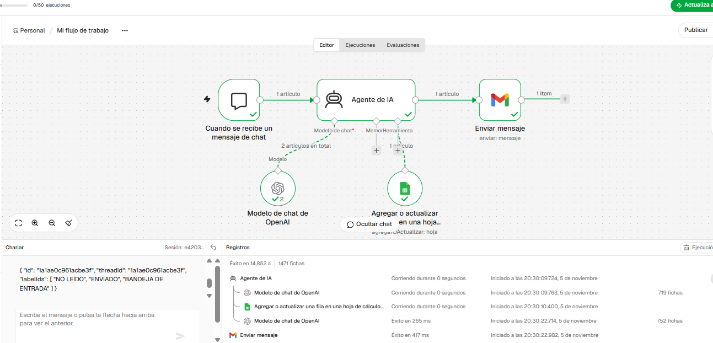

# Checkpoint 1: Asistente Operativo de Calificación y Triaje de Leads

## 📝 Descripción del Caso de Uso
Workflow de n8n que implementa un agente de inteligencia artificial orientado al ámbito corporativo. Su objetivo es interactuar con clientes potenciales, evaluar sus necesidades, extraer sus datos clave (Nombre, Email, Empresa y Necesidad) y registrarlos de forma autónoma en una hoja de Google Sheets, cerrando el circuito con una notificación por Gmail para supervisión humana.

---

## 🏗️ Arquitectura del Workflow
* **Trigger:** Chat Trigger (mensaje desestructurado).
* **AI Agent:** Tools Agent con un límite guardrail de 7 iteraciones (`Max Iterations = 7`).
* **Modelo LLM:** OpenAI Chat Model (`gpt-4o`).
* **Tool:** Google Sheets (`Leads_n8n - Hoja 1`) configurado con prompt semántico extenso.
* **Observabilidad:** Gmail (Notificación con `chatInput` y `output`).

---

## 📸 Evidencia de Ejecución Exitosa

---

## 📁 Archivos del Repositorio
* `checkpoint1_sebastian_rios.json`: Definición completa y exportada del workflow en n8n.
* `ejecucion_exitosa_tp1.png`: Captura de prueba de testing con ejecución completa en verde.
* `README.md`: Documentación del proyecto.
